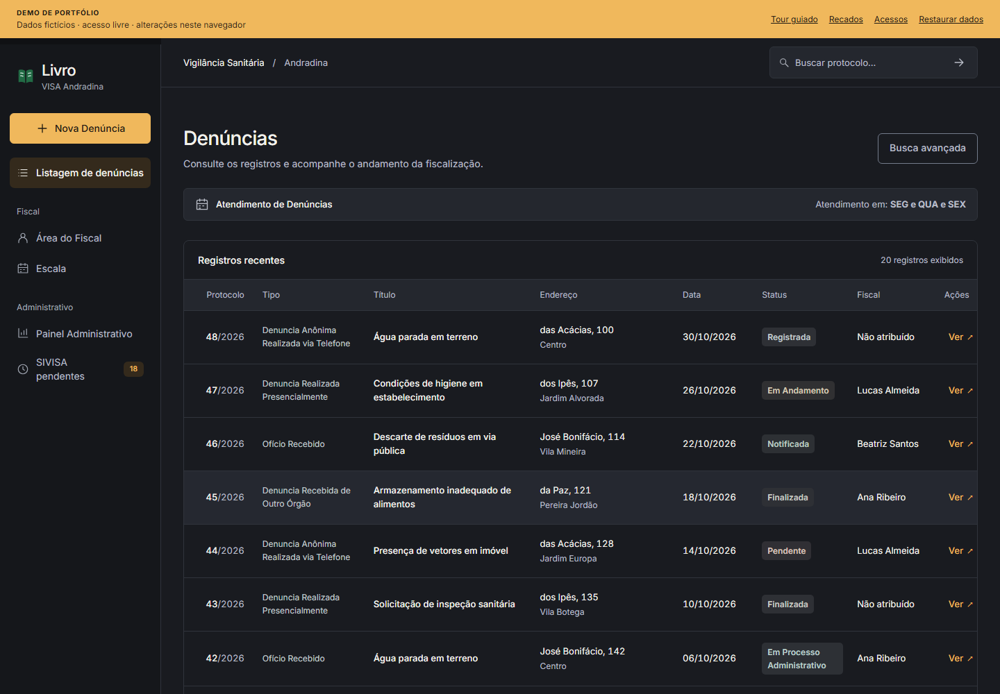
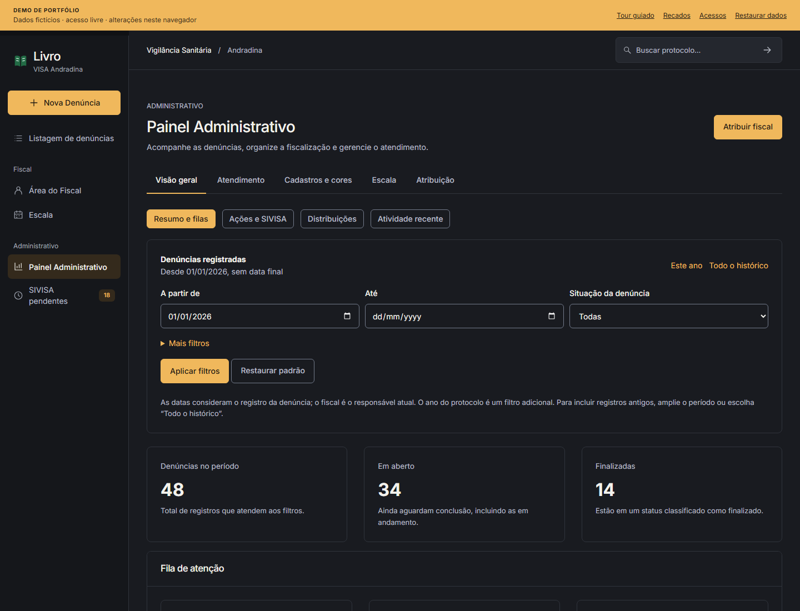

<p align="center">
  
</p>

<h1 align="center">Livro</h1>

<p align="center">Do registro da denúncia à conclusão da fiscalização sanitária.</p>

<p align="center">
  
  
  
</p>

<p align="center">
  <a href="#por-dentro-do-livro">Interface</a> ·
  <a href="#como-explorar-a-demo">Como usar</a> ·
  <a href="#o-que-dá-para-fazer">Funcionalidades</a> ·
  <a href="#executar-localmente">Executar localmente</a> ·
  <a href="https://github.com/self1027/Livro/tree/sistema-completo">Sistema completo</a>
</p>

O Livro é um sistema de gestão da Vigilância Sanitária de Andradina, desenvolvido por Murilo Dias. Ele reúne o registro de denúncias, a distribuição entre fiscais e o acompanhamento das vistorias, com relatórios e indicadores do trabalho da equipe.

A branch `main` apresenta uma demonstração pública para portfólio. Você pode percorrer o atendimento com dados fictícios, sem cadastro ou senha. A interface usa os mesmos templates EJS, estilos, scripts, fontes e imagens da `sistema-completo`, onde está o sistema completo.

## Por dentro do Livro

A listagem reúne os registros recentes, com protocolo, endereço, status e fiscal responsável. Você pode abrir uma denúncia para consultar os detalhes ou usar a busca avançada para filtrar os atendimentos.



No painel administrativo, os filtros por período e situação permitem acompanhar os totais de denúncias registradas, em aberto e finalizadas.



*Capturas da demonstração local, com dados fictícios e o tour desativado.*

## Como explorar a demo

Na tela de entrada, escolha como quer conhecer o sistema:

- **Iniciar tour guiado** acompanha o atendimento em 23 etapas. Você pode pausar e retomar o roteiro.
- **Assistir automaticamente** avança pelas etapas a cada 6,5 segundos, enquanto a aba está visível.
- **Entrar e explorar** libera a navegação para você testar as telas por conta própria.

O roteiro passa pelo cadastro de uma denúncia já preenchida, pela atribuição a um fiscal e pelo registro da vistoria, até a conclusão do atendimento. Ao longo desse processo, os indicadores mostram as mudanças nas filas e na carga de trabalho da equipe.

Use **Restaurar dados** para reiniciar os registros e as configurações e experimentar de novo.

## O que dá para fazer

- Cadastrar denúncias com validação de campos e bairros e protocolo sequencial por ano.
- Distribuir os atendimentos entre fiscais habilitados e consultar suas carteiras com filtros dinâmicos.
- Registrar vistorias, mudar o status e acompanhar o histórico com autoria, incluindo edição e exclusão de relatórios.
- Acompanhar pendências SIVISA, registrar vários protocolos por ação e incluir observações com ou sem protocolo.
- Concluir denúncias e acompanhar totais, filas, carga por fiscal e evolução mensal.
- Combinar buscas por protocolo, endereço, bairro, origem, status e fiscal.
- Consultar gráficos interativos, ações por autor e atividade recente, além de exportar os resultados dos filtros atuais.
- Organizar a escala semanal, com exceções por dia, anotações e configuração do atendimento.
- Configurar bairros, status, origens e cores, além de pessoas, cargos e permissão para receber denúncias.
- Trocar recados locais, referenciar denúncias e consultar anúncios e histórico de conversas.

A exportação CSV é baixada diretamente. Para gerar um PDF, o sistema abre o relatório em outra janela; use **Imprimir / Salvar como PDF** nessa janela.

## Dados e limites da demonstração

Os 48 registros iniciais, pessoas, endereços e relatórios são fictícios. As datas são relativas ao primeiro acesso, para que os indicadores continuem úteis. As alterações ficam no armazenamento local de cada navegador, na chave `livro-demo-v2`, sem sincronização entre visitantes.

A demo precisa de JavaScript e de armazenamento local disponível para manter as alterações entre páginas. Se uma gravação falhar, o sistema exibe um aviso na tela.

Contas e cargos são simulações locais, e as senhas digitadas são descartadas. A demo não faz autenticação real, não envia e-mails nem mensagens a pessoas reais. As autorizações de produção continuam sendo responsabilidade do backend da `sistema-completo`. A fila SIVISA mostra as pendências de toda a equipe para permitir a exploração sem login.

## Executar localmente

<details>
<summary>Instalação e build</summary>

Node.js 22 ou superior:

```sh
npm ci
npm run dev
```

Para gerar e conferir a versão estática:

```sh
npm run build
npm run preview
```

O Vercel usa o build Vite e o diretório `dist`. `vercel.json` mantém o fallback para `index.html`, inclusive em acessos diretos como `/denuncias/new`, `/admin` e `/recados`. Não há banco de dados, variáveis de ambiente ou backend para configurar.

</details>

<details>
<summary>Como a interface é reaproveitada</summary>

`vite.config.js` compila os EJS originais em um script clássico durante o build, preservando seus includes e o escape de conteúdo. `src/demo/render.js` resolve os includes no navegador. `pages.js` entrega os contextos às telas; `store.js`, `actions.js` e `api.js` substituem as operações de servidor por dados locais. Os cálculos de métricas, filtros e validação SIVISA vêm da `sistema-completo`.

Os arquivos originais em `views/` e nos diretórios de ativos de `public/` permanecem idênticos à `sistema-completo`. A referência desta atualização é `0794f5f`. O guia fica em `src/demo/tour.js` e `public/demo.css`.

jQuery e Font Awesome são servidos localmente. Os URLs externos dos templates são adaptados em tempo de execução, sem alterar os arquivos originais. Chart.js e as fontes já são locais na `sistema-completo`.

Para atualizar novamente a interface a partir da `sistema-completo`, revise os contratos de dados junto dos templates:

```sh
git restore --source=sistema-completo -- views public/css public/js public/fonts public/favicon public/vendor public/docs
npm test
npm run test:browser
```

</details>

<details>
<summary>Testes e verificação</summary>

```sh
npm test
npx playwright install chromium
npm run test:browser
```

Os testes Node cobrem o ciclo da denúncia, métricas por data e autoria, persistência, permissões de recebimento, configurações, segurança do CSV e renderização dos templates reais. O Playwright testa o build de produção, o roteiro completo, reprodução e pausa, formulários, exportações, controles administrativos e telas de 375/390px. Capturas e traces ficam em `test-results/`, fora do Git.

As adaptações seguem a skill [Ponytail](https://github.com/DietrichGebert/ponytail), com reúso dos componentes e regras existentes e testes dos comportamentos que podem quebrar.

</details>

---

Desenvolvido por [Murilo Dias](https://murilod.dev/) · [LinkedIn](https://www.linkedin.com/in/murilo-dias-dev/) · [GitHub](https://github.com/self1027)
